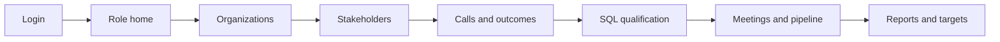
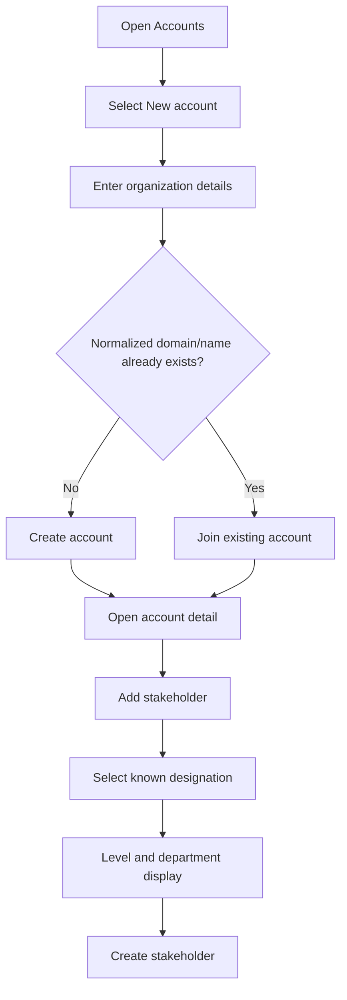
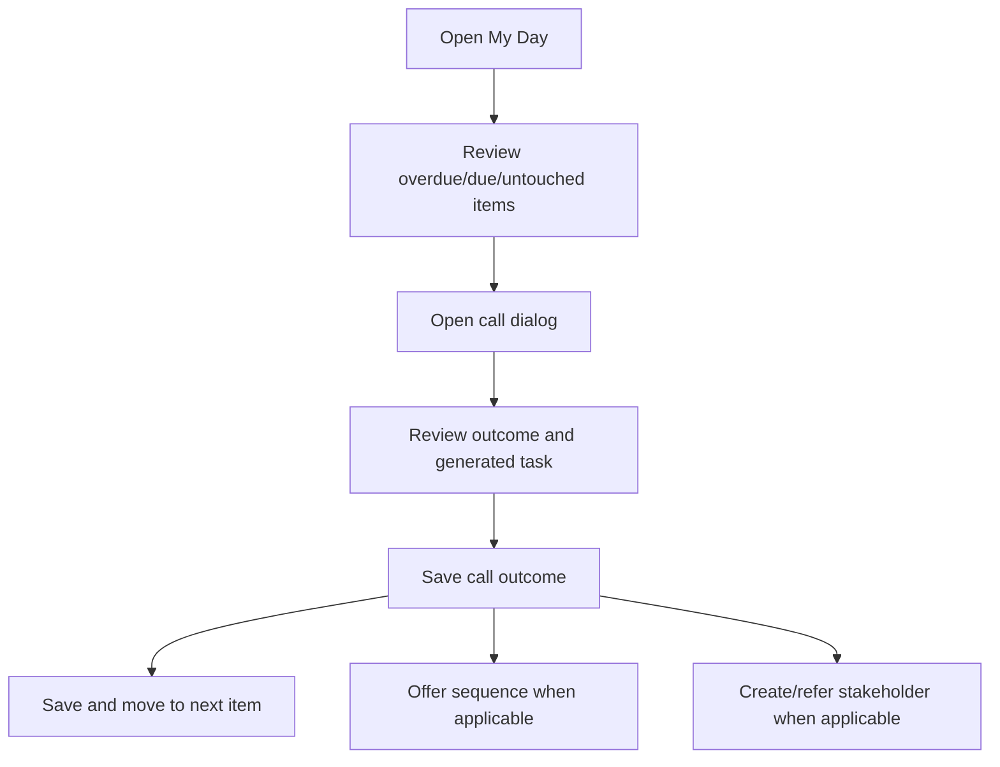
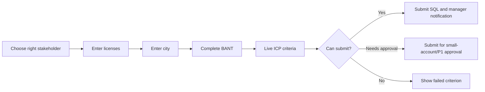
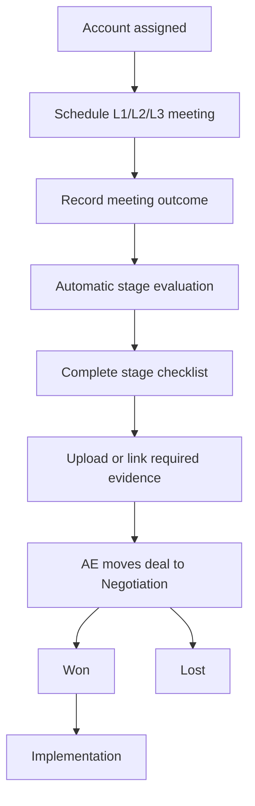
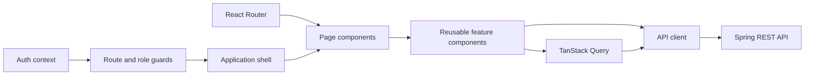
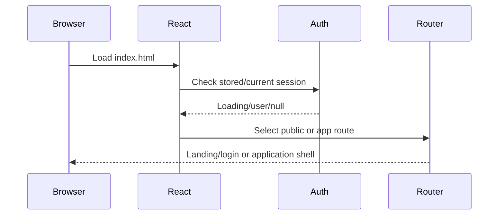
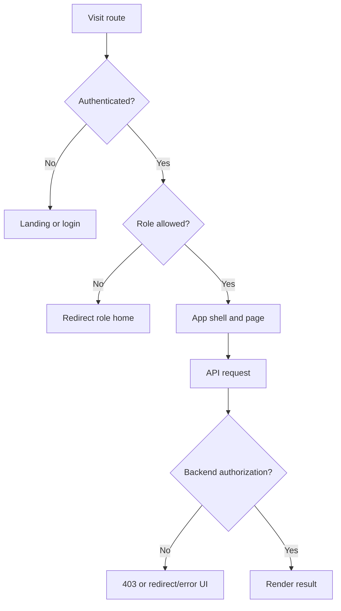
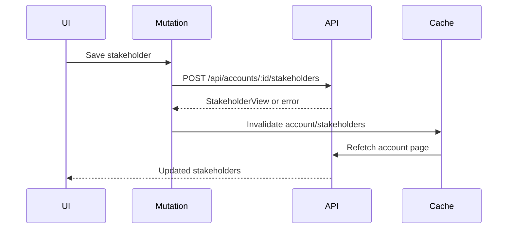

# Prosperr Sales CRM - Frontend

React, TypeScript, Vite, Tailwind CSS, TanStack Query, React Router and a Vite PWA service worker.

## 1. Business perspective

### What this application provides

The frontend is the role-based workspace for the Prosperr sales process:



The app is designed around the work performed by the CRM's roles rather than as one general dashboard.

| Role | Primary workspace |
|---|---|
| BDR | My Day, account creation, stakeholder capture, calling, follow-up tasks and SQL |
| AE | Assigned accounts, pipeline board, meetings, outcomes and opportunity checklist |
| Manager | SQL review, AE assignment, targets, reports and operational monitoring |
| Admin | Everything Manager can do plus users and configuration |

### Business user journeys

#### BDR creates an account



#### BDR works My Day



#### SQL qualification



#### AE manages an opportunity



### Route experience

| Route | Audience | Business purpose |
|---|---|---|
| `/` | Logged-out visitor | Public marketing landing page |
| `/login` | Unauthenticated user | Google/dev login |
| `/welcome` | Signed-in visitor | Marketing/overview entry |
| `/` inside app | Authenticated user | Role home/dashboard |
| `/my-day` | BDR | Ranked daily calling queue |
| `/accounts` | Most roles | Account list, filters, export and creation |
| `/accounts/:id` | Most roles | Account details, stakeholders, timeline and actions |
| `/pipeline` | AE/Manager/Admin | Kanban opportunity management |
| `/sql` | BDR/Manager/Admin | SQL submission or review |
| `/tasks` | Authenticated user | Work items |
| `/reports` | Manager/Admin | Operational analytics |
| `/team` | Manager/Admin | CRM user administration |
| `/settings` | Manager/Admin | CRM configuration |

Roles are guarded again in React and enforced independently in the Spring backend.

---

## 2. Engineering perspective

### Technology

- React 18
- TypeScript
- Vite
- Tailwind CSS
- React Router
- TanStack React Query
- Spring backend REST API
- Lucide icons
- Recharts
- Motion
- `vite-plugin-pwa`
- Workbox-generated service worker

### High-level architecture



The frontend separates:

| Folder | Responsibility |
|---|---|
| `src/pages` | Route-level pages and layout orchestration |
| `src/features` | Reusable business workflows |
| `src/components/layout` | Navigation shell and command menu |
| `src/components/ui` | Generic design-system primitives |
| `src/components/brand` | Branding and illustration components |
| `src/lib` | API, authentication, types, formatting and hooks |
| `src/i18n` | Language resources |
| `public` | PWA manifest assets and static files |

---

## 3. Application startup

`src/main.tsx` creates:

1. React DOM root.
2. `QueryClient` with 30-second stale time.
3. React Query provider.
4. React Router.
5. Authentication provider.
6. Toast notification provider.



`StrictMode` is enabled during development. It can intentionally run certain effect setup/cleanup paths twice, so effects must clean up listeners and timeouts.

---

## 4. Routing and route guards

[App.tsx](src/App.tsx) is the central route table.

Public routes:

- `/`
- `/login`
- `/welcome` for signed-in landing access

Authenticated routes are rendered inside `AppShell`.

[App.tsx](src/App.tsx) defines `Guard`:

```tsx
function Guard({ roles, children }) {
  const { is } = useAuth();
  return is(...roles) ? children : <Navigate to="/" replace />;
}
```

`Guard` improves navigation but is not security.

The backend independently authorizes every API call. Hiding a React route never grants backend access.



---

## 5. Authentication and API client

### Authentication

The authentication context stores the signed-in user state and exposes role helpers.

The login flow:

1. Google obtains an ID token, or dev login is used locally.
2. `/api/auth/google` or `/api/auth/dev-login` returns a CRM JWT.
3. React stores/uses the authenticated session according to the auth implementation.
4. API calls send the JWT.
5. `/api/auth/me` is used to determine identity and role.

### API client

[api.ts](src/lib/api.ts) centralizes HTTP behavior:

- Request URL
- Authorization bearer token
- JSON serialization
- API error parsing
- Download/export requests
- Backend error messages

In development, Vite proxies `/api` to `http://localhost:8081`.

In production, `VITE_API_BASE` can point to the deployed backend.

Example:

```text
VITE_API_BASE=https://api.example.com
```

The backend CORS origin must match the frontend origin.

---

## 6. Server state and React Query

TanStack Query is used for server state. It is not React state for ordinary form fields.

Typical usage:

```tsx
const account = useQuery({
  queryKey: ['account', accountId],
  queryFn: () => api.get(`/api/accounts/${accountId}`)
});
```

Core concepts:

- `queryKey`: identifies unique server data.
- `queryFn`: fetch function.
- `staleTime`: cache freshness.
- `invalidateQueries`: refetch after mutation.
- `mutation`: create/update/delete operation.

Example mutation flow:



The project uses `useAction` to centralize loading, success notifications and cache invalidation.

---

## 7. Account and stakeholder feature

Main files:

- [AccountForms.tsx](src/features/accounts/AccountForms.tsx)
- [AccountDetailPage.tsx](src/pages/AccountDetailPage.tsx)
- [StakeholderView.ts type](src/lib/types.ts)

### Add account

The Add Account form submits:

- Name
- Website/domain
- City
- Industry
- Employee count
- License potential
- Lead source

The backend resolves by normalized domain/name and either creates or joins the account.

### Add stakeholder

The Add Stakeholder form submits:

- Full name
- Designation
- Department override
- Emails
- Phones
- LinkedIn
- Referrer
- Primary SPOC
- Decision maker

### Designation dropdown

The dropdown loads from:

```text
GET /api/config/designations
```

The frontend displays:

```text
Designation · Level · Department
```

The exact designation is sent to the backend.

The backend [DesignationResolver.java](../Crm_Prosperr_backend/prosperr-crm-backend/src/main/java/com/prosperr/crm/account/domain/DesignationResolver.java) normalizes the title and supplies:

- Level L1-L5
- Department
- Priority rank
- Right-POC status

The dropdown is sourced from the existing backend designation map. It does not duplicate business mappings inside React.

An admin can add future titles in Settings; they appear after the designation endpoint returns updated records.

---

## 8. Frontend page functions

| Page | Function |
|---|---|
| `HomePage` | Role-specific dashboard metrics and activity |
| `MyDayPage` | Ranked call/follow-up queue for BDR |
| `AccountsPage` | Search, filters, pagination, export and account creation |
| `AccountDetailPage` | Account data, stakeholders, meetings, opportunity, timeline and actions |
| `PipelinePage` | Kanban pipeline view and stage moves |
| `SqlPage` | SQL criteria submission/review/assignment |
| `TasksPage` | Personal work item list |
| `ReportsPage` | Leadership and operational reports |
| `TeamPage` | CRM user/role management |
| `SettingsPage` | CRM configuration and setup |
| `LandingPage` | Public product landing page |
| `LoginPage` | Authentication entry |

---

## 9. Generic UI components

[ui.tsx](src/components/ui/ui.tsx) contains reusable primitives:

- `Button`
- `Input`
- `Textarea`
- `Select`
- `Field`
- `Checkbox`
- `Modal`
- `Card`
- `Badge`
- `Tabs`
- `Stat`
- `Avatar`

Benefits:

- Consistent labels and validation
- Consistent radius, loading and disabled states
- Less copy/pasted styling
- Accessible labels through `Field`
- Shared behavior for dialogs and forms

---

## 10. PWA install experience

The frontend is an installable Progressive Web App.

[vite.config.ts](vite.config.ts) configures:

- Web app manifest
- App name and short name
- `standalone` display
- Theme/background colors
- 192px and 512px icons
- Maskable icon
- Apple touch metadata
- Workbox service worker
- Automatic PWA update registration

The PWA shell requires HTTPS in production.

On Android/Desktop Chrome or Edge:

1. Open the deployed HTTPS frontend.
2. Click Install App or use the browser menu.
3. The app opens without normal browser navigation chrome.

On iPhone Safari:

1. Open the app.
2. Tap Share.
3. Tap Add to Home Screen.

Limitations:

- A PWA is not a native APK/IPA.
- A QR code can open the deployed URL but cannot bypass browser installation rules.
- The current PWA caches the application shell and assets.
- Offline API mutations are not currently implemented.

---

## 11. Internationalization

The frontend contains i18n resources and `useT`.

The UI should use translation keys rather than hardcoded copy for user-facing labels.

Examples include:

- Stakeholder labels
- AI-assist copy
- Common cancel/add actions
- Page and modal text

Adding a language should require resource updates, not rewriting page logic.

---

## 12. Design patterns used

| Pattern | Usage |
|---|---|
| Container/presentational separation | Pages orchestrate state; feature components implement workflows |
| Composition | Small UI primitives compose larger feature forms |
| Controlled components | React state controls Inputs and Selects |
| Central API client | All HTTP communication through one module |
| Server-state cache | React Query owns remote data |
| Route guards | Role-based navigation |
| Lazy loading | Pages/features are loaded only when requested |
| Feature-module organization | Account, SQL, pipeline and call features are separate |
| Shared design system | Buttons, fields, cards and modals share styles |
| Adapter view | Frontend types represent backend DTOs |
| PWA shell | App manifest and service worker |

---

## 13. Frontend error handling

The API client converts backend errors into frontend-usable errors.

A backend `ProblemDetail` contains:

- HTTP status
- Detail message
- Machine-readable `code`

UI behavior:

- Toast notification for mutation failure
- Inline loading/disabled state
- Conflict errors such as `EDIT_CONFLICT`
- Duplicate stakeholder and account messages
- 403 route/API result handling

Never treat a hidden frontend button as authorization. The backend must return 403 or 422 for unauthorized actions.

---

## 14. Local development

Prerequisites:

- Node.js 20+
- npm
- Backend running on port 8081

Install:

```bash
cd Crm_prosperr
npm install
```

Environment:

```text
VITE_API_TARGET=http://localhost:8081
VITE_GOOGLE_CLIENT_ID=your-google-client-id
VITE_DEV_LOGIN=true
VITE_API_BASE=
```

Run:

```bash
npm run dev
```

Open:

```text
http://localhost:5173
```

Vite proxies `/api` and `/public` to the backend.

### Google login

Create a Google OAuth Web client and configure:

- Authorized JavaScript origin: `http://localhost:5173`
- Same client ID in `VITE_GOOGLE_CLIENT_ID`
- Same client ID in backend `crm.auth.google-client-id`

Dev login is intended only for local development.

---

## 15. Build and deploy

Type-check and build:

```bash
npm run build
```

This runs:

```text
TypeScript type-check
Vite production bundle
PWA manifest generation
Service-worker generation
```

Preview:

```bash
npm run preview
```

Deploy `dist/` to an HTTPS static host.

Important deployment settings:

| Setting | Purpose |
|---|---|
| `VITE_API_BASE` | Absolute backend API URL when frontend and backend use different origins |
| Backend `FRONTEND_URL` | CORS origin |
| Backend `APP_BASE_URL` | Public backend URL |

If frontend and backend use a reverse proxy, `/api` can remain relative and the Vite proxy is not used in production.

---

## 16. PWA build artifacts

A production build generates:

```text
dist/manifest.webmanifest
dist/sw.js
dist/registerSW.js
dist/icons/*
dist/assets/*
```

The browser obtains the manifest and service worker through [index.html](index.html).

The manifest controls:

- Installed app name
- Start URL
- Standalone display
- Theme/background color
- Launcher icons

---

## 17. Project structure

```text
src/
├── App.tsx
├── main.tsx
├── pages/
├── features/
│   ├── accounts/
│   ├── calls/
│   ├── pipeline/
│   ├── sql/
│   └── reports/
├── components/
│   ├── brand/
│   ├── layout/
│   ├── landing/
│   └── ui/
├── lib/
│   ├── api.ts
│   ├── auth.tsx
│   ├── hooks.ts
│   ├── i18n.tsx
│   ├── queries.ts
│   └── types.ts
├── i18n/
└── assets/

public/
├── favicon.png
└── icons/

docs/
├── DESIGN.md
└── MEDIA-PLAN.md
```

---

## 18. Engineering decisions

### Why React Query

It treats HTTP data as cacheable server state instead of manually storing every response in global React state.

### Why a shared API client

Authentication, error handling and URL construction stay in one place.

### Why feature folders

Account, SQL and pipeline workflows evolve independently. One feature can contain a modal, form and API mutations without polluting every page.

### Why route guards

They provide correct UI navigation for known roles. Backend authorization remains the real security boundary.

### Why PWA

It provides an app-like standalone launch experience with low deployment cost. It is used for installability, not offline database replacement.

### Why backend designation lookup

The frontend dropdown does not become the source of business truth. The backend designation map supplies level, department and priority so the database and API remain authoritative.
